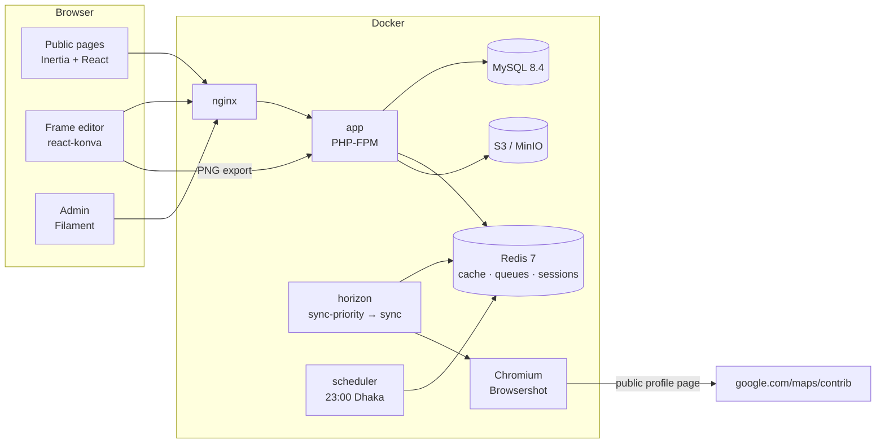

# Bangladesh Local Guides — Stats & Photo Frames

Community site for the **Bangladesh Local Guides** (Google Maps Local Guides):

- **Home page** for the community, with the open event frames (public editor links) and an admin-curated gallery of members' frames (public share links)
- **Leaderboard / profiles / compare**, built from public Google Maps contributor stats that are refreshed daily
- **Photo frame generator**: members pick an event frame, add 1–3 photos and get a PNG with their stats filled in, plus a share link with a proper preview image
- **Admin panel** (Filament) for profiles, events, frames (with live preview), generated frames, sync logs and home page content

Laravel 12 · PHP 8.3 · MySQL 8.4 · Redis 7 · Horizon · Inertia + React + TypeScript + Tailwind (shadcn/ui) · react-konva · Filament 5 · Browsershot (Chromium) · Intervention Image 3 (Imagick + libheif) · S3/MinIO · Pest.

## Quick start

Requires Docker (Compose v2). Everything runs in containers.

```bash
cp .env.example .env && make up && make fresh
```

On Windows without `make`, use the PowerShell twin with the same targets:

```powershell
Copy-Item .env.example .env; ./dev.ps1 up; ./dev.ps1 fresh
```

The first `up` builds the image (Chromium, fonts, imagick and so on take a few minutes) and installs Composer and npm packages into volumes. `fresh` migrates and seeds an admin, about 50 demo guides with 90 days of history, and the sample "12th Anniversary — 03 Reviews, Photos & Accessibility" frame.

| What | URL | Login |
|---|---|---|
| App | http://localhost | register any member account |
| Admin (Filament) | http://localhost/admin | `admin@example.com` / `ADMIN_PASSWORD` (default `password`) |
| Horizon | http://localhost/horizon | admin only |
| MinIO console | http://localhost:9001 | `minio` / `minio-secret` |
| Mailpit | http://localhost:8025 | — |
| Vite (HMR) | http://localhost:5173 | — |

If port 80 or 13306 is taken, set `APP_PORT` / `FORWARD_DB_PORT` in `.env` and update `APP_URL`.

**Try it:** paste `https://maps.app.goo.gl/4KNXhprYBX5dsAdWA` into "Add your profile" on the home page. It is queued on `sync-priority`, and a minute or so later the profile shows real stats. Watch it in Horizon.

## Commands

| make | dev.ps1 | does |
|---|---|---|
| `make up` | `./dev.ps1 up` | build and start all services |
| `make down` | `./dev.ps1 down` | stop |
| `make shell` | `./dev.ps1 shell` | bash in the app container |
| `make migrate` | `./dev.ps1 migrate` | run migrations |
| `make fresh` | `./dev.ps1 fresh` | `migrate:fresh --seed` |
| `make test` | `./dev.ps1 test` | Pest: unit + feature, then the Chromium browser group |
| `make pint` | `./dev.ps1 pint` | format PHP |
| `make stan` | `./dev.ps1 stan` | Larastan (level 6) |
| `make lint` | `./dev.ps1 lint` | ESLint + Prettier check |
| `make logs` | `./dev.ps1 logs` | tail all logs |

Useful artisan commands (inside `make shell`):

```bash
php artisan guides:fetch 107121503923715912205 --text   # render + parse one profile (debug)
php artisan guides:sync-all                             # queue the daily batch now
php artisan frames:purge-sources                        # delete originals > 30 days, temp uploads > 24 h
FEATURE_SERVER_RENDER=true php artisan frames:render <frame-slug> [contrib_id] --out=/tmp/x.png
```

## Architecture



**Profile sync (Module A + B)**

1. `ContribIdResolver` accepts a profile URL, a `maps.app.goo.gl` short link or the app's share text. Redirects are followed one hop at a time, and every hop must be HTTPS to an allowlisted Google host (SSRF protection).
2. `SyncLocalGuide` runs on Horizon. `GoogleMapsThrottle` allows 4 per minute plus 5–15 s of jitter. `BrowsershotProfileFetcher` renders the page and opens the "Contributions from …" panel, and `ProfileTextParser` applies the regexes from `config/localguides.php`.
3. Results go to `local_guides`, a daily `local_guide_snapshots` row and `sync_logs` (with a 2,000-character text excerpt). Restricted profiles keep their old stats. After 3 consecutive failures the status becomes `failed`.
4. The scheduler queues every active, pending and restricted profile at 23:00 Asia/Dhaka. When the batch finishes, the leaderboard cache is busted.

**Frame generator (Module C)**

- Uploads are checked by real MIME type, then HEIC is converted to JPEG, the photo is auto-oriented, resized to at most 2000 px and stripped of EXIF/GPS. They're stored privately under `tmp/` and served through signed, same-origin URLs, so the canvas is never tainted.
- `resources/js/frame/frame-stage.tsx` draws background → photos (cover-fit, clipped, rotated) → overlay → text (compact numbers, shrink to fit, hide unknowns) → QR. It exports at the frame's native size.
- The same component powers the admin live preview and the optional server renderer (`FEATURE_SERVER_RENDER`).
- `/f/{ulid}` is the share page. OG and Twitter tags are rendered server-side, because WhatsApp and Facebook don't run JavaScript.

## Environment variables

Everything is in `.env.example`. The ones you're most likely to change:

| var | default | meaning |
|---|---|---|
| `APP_URL`, `APP_PORT` | `http://localhost`, `80` | public URL and host port |
| `APP_LOCALE` | `bn` | default UI language (`bn`/`en`, switcher in the header) |
| `ADMIN_EMAIL`, `ADMIN_PASSWORD` | `admin@example.com`, `password` | admin seeded by `make fresh` |
| `FILESYSTEM_DISK` | `s3` | uploads and frames storage |
| `AWS_*` | MinIO | S3 credentials. `AWS_URL` is the browser-facing base URL for `public/` files (CloudFront in prod) |
| `LG_SYNC_PER_MINUTE` | `4` | max Google Maps page loads per minute |
| `LG_SYNC_PROCESSES` | `2` | concurrent Chromium workers (Horizon `sync` supervisor) |
| `LG_SYNC_WAIT_MS`, `LG_SYNC_TIMEOUT` | `4000`, `45` | settle delay after the profile renders; page timeout (s) |
| `LG_SYNC_JITTER_MIN/MAX` | `5`/`15` | random pause between scrapes (s) |
| `REDIS_QUEUE_RETRY_AFTER` | `330` | must exceed the longest job timeout |
| `FEATURE_SERVER_RENDER` | `false` | enable the Browsershot frame renderer |
| `RENDER_INTERNAL_URL` | `http://nginx` | how Chromium in Docker reaches the app |
| `BROWSERSHOT_CHROME_PATH` | `/usr/bin/chromium` | system Chromium in the image |

## Production

```bash
docker compose -f docker-compose.yml -f docker-compose.prod.yml up -d --build
```

The `prod` image target contains the built Vite assets, has no dev dependencies, runs with opcache on and caches its config at boot. The prod override drops the bind mounts and the dev-only services (vite, MinIO, Mailpit). Copy `.env.production.example` to `.env` and set real secrets, AWS S3 and `AWS_URL=https://<cloudfront-domain>`. Run `php artisan migrate --force` after each deploy.

## Docs

- [`docs/DECISIONS.md`](docs/DECISIONS.md): choices made where the spec was open
- [`docs/FRAME_CONFIG.md`](docs/FRAME_CONFIG.md): frame JSON spec for designers and admins
- [`docs/PARSER.md`](docs/PARSER.md): how profile parsing works and how to fix it when Google changes its UI

## Tests

```bash
make test
```

Pest suites:

- **Unit**: resolver, parser fixtures, compact formatter, frame config validation
- **Feature**: add profile, sync job (fake fetcher), leaderboard, profile and compare pages, uploads (HEIC, EXIF/GPS, MIME), generations, share-page OG tags, admin access and actions
- **Browser**: real Chromium Bengali conjunct shaping

CI (`.github/workflows/ci.yml`) runs Pint, Larastan, Pest (in the same Docker image, against MySQL and Redis service containers), ESLint, Prettier, `tsc` and a production Vite build.
